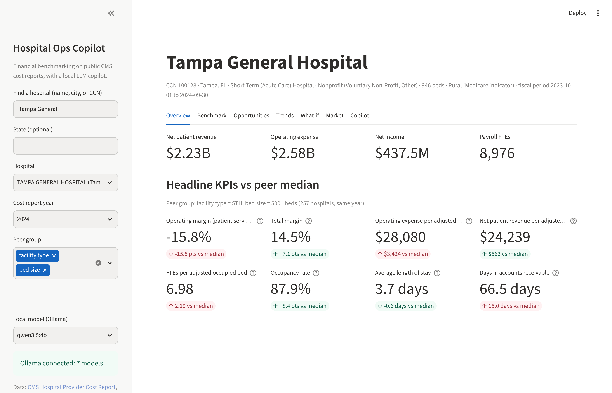
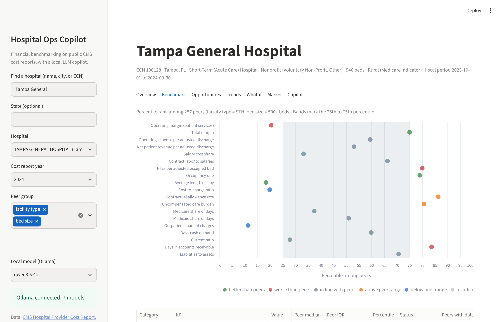
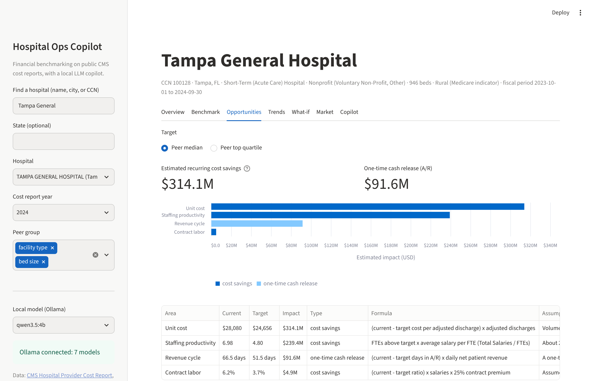
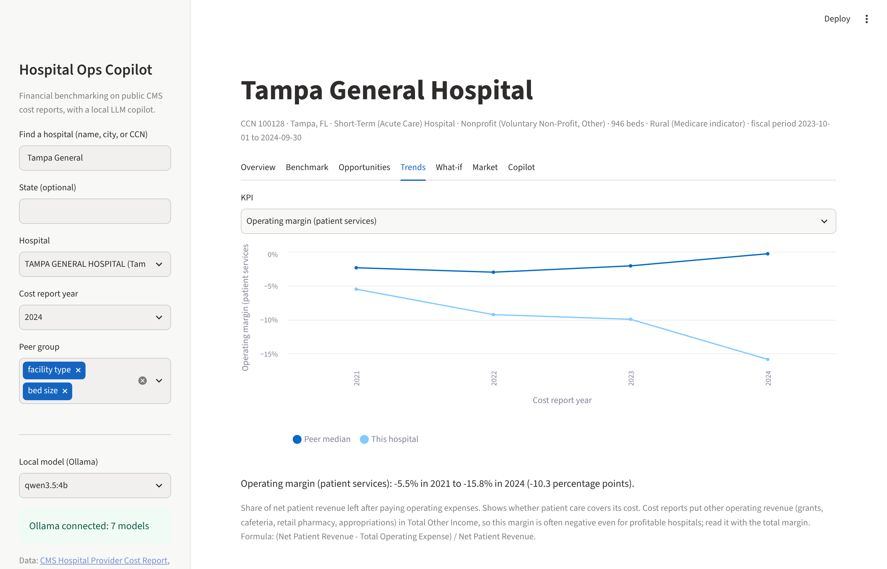

# Hospital Ops Copilot

AI-powered hospital financial benchmarking and decision support using public CMS data, transparent
analytics, and evidence-grounded insights. Runs entirely on free, local models through
[Ollama](https://ollama.com): no API keys, and no data leaves your machine.



## What it does

Pick any of the 6,264 Medicare-certified US hospitals in the CMS Hospital Provider Cost Report
(cost report years 2021 to 2024) and get:

- **Peer benchmarking.** 19 KPIs (margins, cost and revenue per adjusted discharge, staffing,
  contract labor, occupancy, length of stay, payer mix, liquidity, revenue cycle) compared with a
  peer group you define. Each KPI shows percentile rank, peer median, and the 25th to 75th
  percentile range.
- **Opportunity sizing.** Dollar estimates for closing the gap to the peer median or top quartile:
  unit cost, staffing productivity, contract labor, revenue cycle cash, length-of-stay capacity, and
  revenue yield. Every formula and assumption is shown, and overlapping gaps are not double-counted.
- **Trends** against the peer median for every year on file.
- **What-if scenarios** for volume, payment rate, operating expense, and labor cost changes.
- **Market rankings** by any KPI, state, facility type, and size.
- **A copilot** that answers plain-English questions ("Where are our biggest savings
  opportunities?", "What happens to our margin if labor costs rise 4%?") with a local LLM. The model
  calls the analytics engine through tools and never computes figures itself. Each answer gets:
  - **Sources** taken from the tools that ran: the CMS report ID, fiscal period, and fields.
  - **A grounding check** that traces every number in the answer back to tool output and flags
    any it cannot.

## Why it is built this way

Hospital finance teams cannot act on numbers they cannot audit, and small local models misstate
numbers. The design keeps the model out of the arithmetic:

| Concern | Approach |
|---|---|
| Accuracy | Deterministic Python computes every figure; the LLM chooses tools and explains results |
| Hallucinated numbers | Post-answer numeric grounding check, with unverified figures flagged in the UI |
| Hallucinated sources | Citations are built from tool outputs, never from model text |
| Privacy and cost | Free open-weight models on Ollama; public data only; runs offline |
| Reliability | If Ollama is down, an offline analyst answers with the same tools and templated wording |
| Transparency | KPI formulas, CMS source fields, peer definitions, and assumptions are visible everywhere |

See [docs/architecture.md](docs/architecture.md) for the full design and
[docs/methodology.md](docs/methodology.md) for the benchmarking methods.

## Model choices

Chosen by running this project's own evaluation suite on candidate models (details and full results
in [docs/model_selection.md](docs/model_selection.md)):

| Role | Default | Alternatives |
|---|---|---|
| Chat and tool calling | `qwen3.5:4b` (3.3 GB) | `qwen3.5:9b` or `gemma4:12b` with 12 GB+ VRAM; `llama3.2:3b` for low-end CPUs |
| Embeddings | `embeddinggemma` (622 MB) | `qwen3-embedding:0.6b`, `nomic-embed-text` |
| Retrieval | Hybrid BM25 + dense, reciprocal rank fusion | BM25 only (no model needed) |

Switch models with environment variables, for example `HOC_CHAT_MODEL=llama3.2:3b`, or pick one in
the app sidebar.

## Evaluation

<!-- EVAL_TABLE_START -->
Results pending.
<!-- EVAL_TABLE_END -->

Reproduce with `make eval-retrieval` and `make eval-agent`. Expected answers are computed from the
data at run time, so the suite stays valid when the dataset is refreshed.

## Quickstart

### Option A: Docker (app, API, and Ollama together)

```bash
docker compose up
```

Open http://localhost:8501 for the app and http://localhost:8000/docs for the API. The first start
pulls `qwen3.5:4b` and `embeddinggemma` (about 4 GB).

### Option B: Local Python

Requires Python 3.11+ and, for the copilot, [Ollama](https://ollama.com/download).

```bash
pip install -e ".[dev]"
```

```bash
ollama pull qwen3.5:4b && ollama pull embeddinggemma
```

```bash
hoc ui
```

The processed dataset ships in `data/processed/`, so the app works right after install. Without
Ollama, the copilot runs in offline analyst mode.

To rebuild the data from CMS:

```bash
hoc download && hoc build
```

### CLI

```bash
hoc ask "How does Tampa General Hospital compare to its peers in 2023?"
```

```bash
hoc ask "What would a 4% labor cost increase do to our operating margin?" --ccn 240010
```

### API

```bash
curl "localhost:8000/hospitals/100128/benchmark?year=2023"
```

```bash
curl -X POST localhost:8000/ask -H "content-type: application/json" -d '{"question": "Where can we save money?", "ccn": "100128"}'
```

Endpoints: `/health`, `/kpis`, `/hospitals/search`, `/hospitals/{ccn}`, `/hospitals/{ccn}/benchmark`,
`/hospitals/{ccn}/opportunities`, `/hospitals/{ccn}/trend`, `/hospitals/{ccn}/scenario`,
`/rankings/{kpi}`, `/ask`.

## Screens

| Benchmark | Opportunities |
|---|---|
|  |  |
| **Trends** | **Copilot** |
|  |  |

## Data

Source: [CMS Hospital Provider Cost Report](https://data.cms.gov/provider-compliance/cost-report/hospital-provider-cost-report),
a public use file built from HCRIS (form CMS-2552-10). It is US government data, in the public domain.

| | |
|---|---|
| Cost report years | 2021, 2022, 2023, 2024 |
| Hospital-years | 24,060 (6,264 hospitals) |
| Fields used | 63 of 117 |
| KPIs | 19, defined once in [`analytics/kpis.py`](src/hospital_ops_copilot/analytics/kpis.py) ([glossary](docs/kpi_glossary.md)) |

Important limitations: cost reports are unaudited and filed per hospital (system-level cost sharing
can distort results); there is no case mix index, so cost per case is not acuity-adjusted; and the
operating margin counts only patient revenue, so read it with the total margin. See
[docs/methodology.md](docs/methodology.md#limitations).

## Project structure

```
src/hospital_ops_copilot/
  data/        download from data.cms.gov, clean, derive KPIs
  analytics/   KPI catalogue, data store, benchmarking engine
  rag/         corpus and hybrid retriever
  llm/         Ollama client, tools, agent, grounding check, offline analyst
  api/         FastAPI service
  ui/          Streamlit app
evals/         retrieval and agent evaluation suites
tests/         unit and integration tests (synthetic data, no network)
docs/          architecture, methodology, KPI glossary, model selection, CMS source documents
```

## Development

```bash
make test
```

```bash
make lint
```

CI runs lint, tests, and an offline copilot smoke test on every push.

## Disclaimer

An independent portfolio project built only on public CMS data. Not affiliated with or endorsed by
CMS or any hospital. Benchmarks show where to look, not what to cut; they are not financial advice.

## License

MIT, see [LICENSE](LICENSE).
