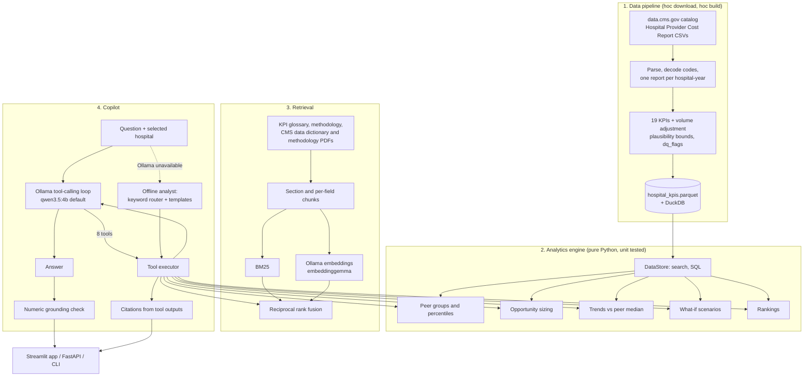

# Architecture

Hospital Ops Copilot has four layers. Only the top one uses a language model, and it never does
arithmetic: every figure comes from deterministic Python over CMS data.

## Design decisions

**The LLM chooses tools; Python computes numbers.** Small local models are good at mapping a
question to a function call and at writing a short explanation. They are unreliable at arithmetic
and at recalling figures. Every number is computed by the analytics engine and passed to the model
already formatted (for example "8.5%" or "$24,121"), so the model only has to copy it.

**Compact tool views.** Each tool returns two things: the full result (for the UI, citations, and
the grounding check) and a short JSON view for the model. Small models with 8K context windows lose
accuracy when tool outputs are long, so the view keeps only what an answer needs.

**Grounding check instead of trust.** After the model answers, `llm/grounding.py` extracts every
number from the text and looks for it in the full tool outputs. It accepts display rounding, unit
changes (0.084 shown as 8.4%), K/M/B suffixes, and differences between sibling values ("2.1 points
above the median"). Anything else is shown to the user as unverified. This makes hallucinated
figures visible instead of silent.

**Citations come from tools, not from the model.** Each tool result carries the dataset, year, CCN,
CMS report ID, fiscal period, and field names it used. The UI lists these under the answer, so a
model cannot invent a source.

**Graceful degradation.** If Ollama is not running, the same tools are called by a keyword router
with templated answers. The app, the API, and CI all work without a GPU or a model download. The
offline analyst is also the baseline in the evaluation.

**Hybrid retrieval.** Definitions and methodology questions are answered from a small corpus: the
KPI glossary (generated from the KPI catalogue in code, so it never drifts from the formulas), the
methodology page, and the CMS data dictionary split into one chunk per field. BM25 handles exact
field names; embeddings handle paraphrases such as "how full are our beds". Reciprocal rank fusion
combines them without score calibration.

**One source of truth for KPIs.** `analytics/kpis.py` defines each KPI once: formula, unit,
favorable direction, CMS source fields, and plausible bounds. The pipeline, benchmark statuses,
UI tooltips, tool schemas, and RAG glossary are all generated from it.

## Module map

| Path | Purpose |
|---|---|
| `data/download.py` | Resolve yearly CSV URLs from the data.cms.gov DCAT catalog and download them |
| `data/build.py` | Clean, deduplicate, derive KPIs, write Parquet and DuckDB |
| `data/codes.py` | CMS code tables (provider type, control, facility type), bed bands |
| `analytics/kpis.py` | KPI catalogue and formatting |
| `analytics/store.py` | Data access, hospital search, SQL |
| `analytics/benchmark.py` | Peer groups, percentiles, opportunities, trends, scenarios, rankings |
| `rag/corpus.py`, `rag/index.py` | Retrieval corpus and hybrid retriever |
| `llm/ollama_client.py` | Minimal Ollama REST client (chat with tools, embeddings) |
| `llm/tools.py` | Tool schemas, executor, compact views |
| `llm/agent.py` | Tool-calling loop, text tool-call parsing, fallback |
| `llm/grounding.py` | Numeric grounding verifier |
| `llm/narrator.py` | Offline analyst |
| `api/main.py` | FastAPI service |
| `ui/app.py` | Streamlit app |
| `evals/` | Retrieval and agent evaluation suites |
